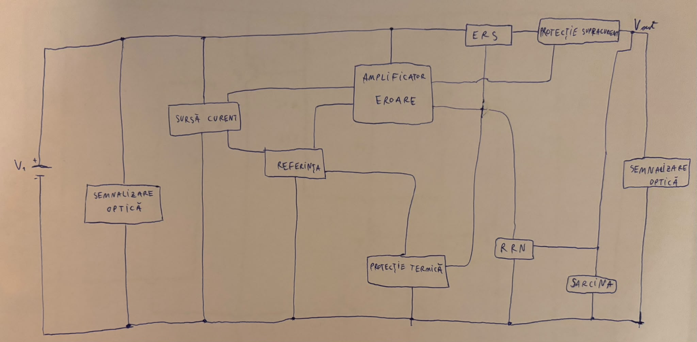
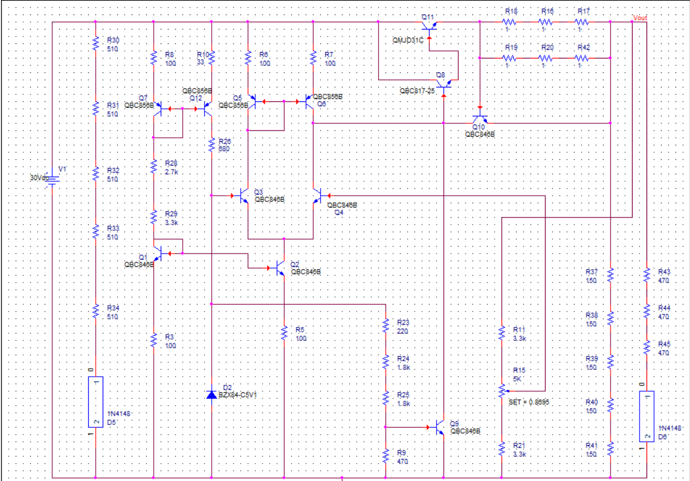
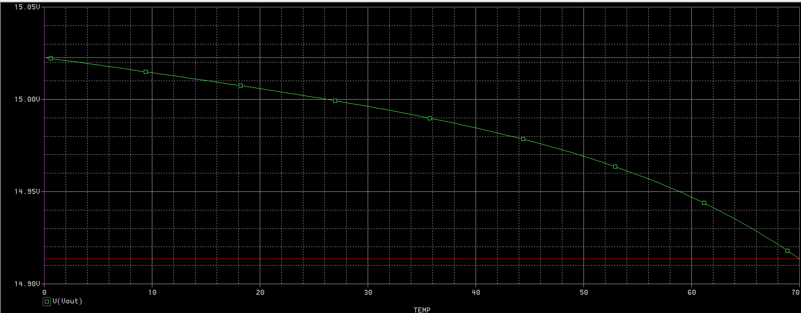
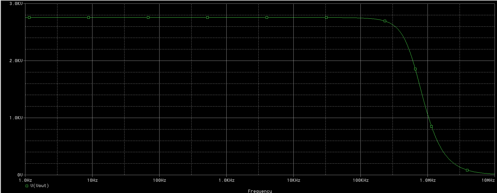
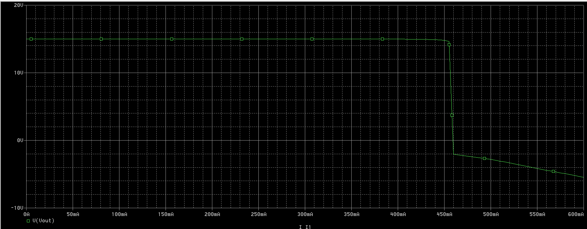

# Series-Pass Voltage Regulator (7.5-15 V, 0.4 A)

Adjustable linear voltage regulator built from discrete SMD components, designed and simulated in **OrCAD Capture / PSpice**, with a **40 x 40 mm two-layer SMT PCB** as the final deliverable.
University project (Fundamental Electronic Circuits 2 / Project 1), UNSTPB, Faculty of ETTI.

> **Status: in progress.** Circuit design and PSpice simulations are complete. PCB layout and manufacturing files (Gerber / Excellon) are in progress.

## Specifications

| Parameter | Requirement |
|---|---|
| Input voltage | 27-30 V |
| Output voltage | 7.5-15 V, adjustable |
| Load | 750 Ω |
| Thermal drift | < 2 mV/°C |
| Overcurrent protection | 0.4 A |
| Overtemperature protection | series-pass transistor limited to 100 °C |
| Error amplifier open-loop gain | ≥ 200 |
| Operating temperature | 0-70 °C |
| Indicators | LEDs for input and output voltage presence |

## Architecture

| Block | Role | Main components |
|---|---|---|
| Constant-current source | Biases the Zener and the differential pair independently of Vin | BC846B / BC856B current mirrors |
| Voltage reference | ~5.1 V reference, fed from a constant current | BZX84C5V1 Zener |
| Error amplifier | Differential pair with active current-mirror load | BC846B / BC856B |
| Feedback network | Adjustable divider sets Vout between 7.5 V and 15 V | 5 kΩ SMD potentiometer (3314G-1-502E) |
| Series-pass element | Darlington pair delivering the load current | BC817-25 + MJD31C (D-PAK) |
| Overcurrent protection | Sense resistors turn on a transistor that throttles the drive | BC846B + 1 Ω resistors |
| Thermal protection | V_BE of a transistor (≈ -2 mV/°C) triggers shutdown near 100 °C | BC846B + resistor divider |
| Indicators and load | Input/output LEDs, 750 Ω load | 0805 chip resistors, SMD LEDs |

All passive components are standard-value 0805 chip parts; semiconductors are catalogue SMD parts (SOT-23, D-PAK).

## Schematic

## Simulation results (PSpice)

| Test | Result |
|---|---|
| Thermal drift, 0-70 °C | Vout 15.023 V → 14.914 V, **≈ 1.6 mV/°C** (requirement: < 2 mV/°C) |
| Error amplifier open-loop gain | **≈ 2.7 × 10³** (requirement: ≥ 200) |
| Overload sweep | Output drops sharply at ≈ 0.45 A load current |

Additional simulations are in `images/simulations/`: bias point (voltages, currents, power at two potentiometer settings), stability, and thermal protection.

## PCB requirements (layout in progress)

- FR4, 2 layers, 35 µm copper, 2 mm thickness, 40 x 40 mm, origin at bottom-left corner
- All components on TOP; 0805 chip passives; SMD transistors only (SOT-23, D-PAK)
- Trace widths: 28 mil (1 A), 20 mil (hundreds of mA), 18 mil (signal); spacing 16 mil; vias 0.4 mm
- 1.1 mm board-edge clearance, 2 global fiducials, up to 4 rectangular test points
- Outputs: Gerber RS-274X (outline, TOP, BOTTOM, silkscreen, solder mask, solder paste) and Excellon drill file
- Designed with IPC-2221A, IPC-7527 and IPC-A-610 in mind

## Repository contents

| Path | Content |
|---|---|
| `docs/project_documentation_ro.pdf` | Design documentation with sizing calculations (in Romanian) |
| `docs/BOM.md` | Bill of materials (semiconductors and passives) |
| `orcad/` | OrCAD Capture project (`SERS.opj`, `SERS.DSN`) |
| `images/` | Block diagram, schematic and simulation plots |

## Tools

OrCAD Capture, PSpice, Cadence Allegro PCB Editor (Lite).
